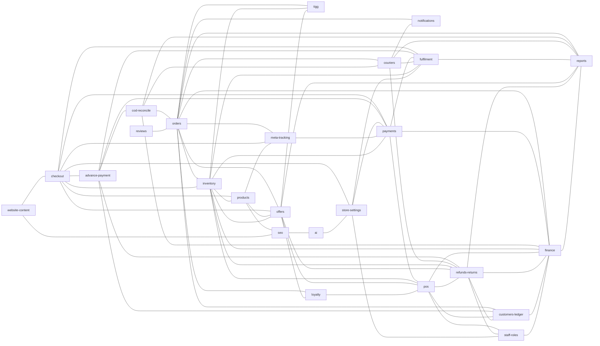

# Feature map

**Read this before changing an existing feature or building a new one.** Blanxer's features are
linked: an advance payment needs an online payment method, a refund moves money, stock, offers and
the customer ledger at once, a checkout change reaches the storefront, the kit and the MCP. This
map says, for every feature, where its code is in each repo, which rules and tests guard it, what
it is linked to and what each of its settings needs to keep working.

The map is `feature-map.json` in this folder. The same three files (`feature-map.json`, this
README and `scripts/claude/impact.cjs`) are in every Blanxer repo: backend, dashboard, app,
storefront, storefront kit and MCP.

**Open findings** from the audit that built this map (security holes closed, settings that
dangled, rules copied across repos, owner decisions still needed): `docs/feature-map/findings-2026-11-13.md`
in the backend repo.

## How to use it

```bash
node scripts/claude/impact.cjs                 # what my branch touches, and what to check
node scripts/claude/impact.cjs checkout        # one feature: code in every repo, rules, tests, links
node scripts/claude/impact.cjs src/features/order/service/advance.ts   # who owns a file
node scripts/claude/impact.cjs pickup          # search features, settings and single homes
node scripts/claude/impact.cjs --list          # every feature
```

In Claude Code a hook does this for you: the first time a session edits a file of a feature, the
feature's links, rules, settings and its copies in the other repos are put in front of the agent.

## The rules for agents

1. **Before you change a feature, read its brief** (`impact.cjs <feature>`) and the rules docs it names.
2. **Check every linked feature** the brief lists. In your final report, say which you checked and how.
3. **A setting that needs something else** (see "Settings that depend on something else") must stay
   valid on every path that removes what it needs: the setting turned off, a plugin uninstalled, a
   plan downgraded or expired, an outlet deactivated, a referenced record deleted. Switch the
   dependent setting off, ignore it at read time, or refuse the change; add a test for each path.
   The advance-payment bug (advance on, last online payment turned off, nobody could order) is the
   example: PR #386, rule AP-24.
4. **One home only.** A rule in "One home only" lives in one place. Call it; never write a second
   copy. When a client needs the rule, it shows the backend's answer, and its copy (listed there)
   has a contract test against backend fixtures.
5. **Keep the map true in the same PR.** New feature, new folder, new link, new setting that
   needs something: add it to `feature-map.json`, run `--render`, then `--sync` to the other repos.
   `--check` fails when a path no longer exists or a new source folder belongs to no feature.

## Keeping the map

```bash
node scripts/claude/impact.cjs --check         # valid for this repo (run by the repo's check)
node scripts/claude/impact.cjs --render        # rewrite the generated part of this README
node scripts/claude/impact.cjs --sync ../bd-x ../app-x ../sf-x ../kit-x ../mcp-x   # copy to other repos
node scripts/claude/impact.cjs --check-all dashboard=../bd-x app=../app-x storefront=../sf-x kit=../kit-x mcp=../mcp-x
```

Edit the map in the backend first, then sync. Every feature has `paths` per repo (globs; a folder
owns everything under it), `rules`, `tests`, `watch` (what must never break), and `links` (`to`,
`why`, `check`). A link is written once, on either side; both features show it.

<!-- generated:start (node scripts/claude/impact.cjs --render) -->

## Features

| Feature | What it is | Linked to |
|---|---|---|
| [`orders`](#orders) | Orders: create, list, detail, status, edit, delete, labels, exports | `cod-reconcile`, `couriers`, `customers-ledger`, `finance`, `inventory`, `loyalty`, `meta-tracking`, `notifications`, `offers`, `reports`, `reviews`, `tigg` |
| [`checkout`](#checkout) | Website checkout: cart, quote, place order, pay, stock holds | `advance-payment`, `fulfilment`, `inventory`, `meta-tracking`, `offers`, `payments`, `products`, `store-settings`, `website-content` |
| [`advance-payment`](#advance-payment) | Advance payment: pay part online, the rest on delivery | `checkout`, `cod-reconcile`, `customers-ledger`, `fulfilment`, `payments`, `refunds-returns` |
| [`payments`](#payments) | Online payments: gateways, BlanxerPay, settlements, payment settings | `advance-payment`, `checkout`, `finance`, `fulfilment`, `inventory`, `meta-tracking`, `pos`, `store-settings` |
| [`cod-reconcile`](#cod-reconcile) | COD and Reconcile: courier remittances, Waiting Reconcile, shortfalls | `advance-payment`, `couriers`, `finance`, `orders`, `reports` |
| [`couriers`](#couriers) | Couriers and logistics: send, track, webhooks, comments, shipments | `cod-reconcile`, `fulfilment`, `notifications`, `orders`, `refunds-returns`, `reports` |
| [`fulfilment`](#fulfilment) | Fulfilment and multi-outlet: store pickup, fulfil from, pooled stock, routing | `advance-payment`, `checkout`, `couriers`, `inventory`, `payments`, `reports`, `store-settings` |
| [`inventory`](#inventory) | Inventory: stock, batches, outlets, stock moves, advanced inventory | `checkout`, `finance`, `fulfilment`, `offers`, `orders`, `payments`, `pos`, `products`, `refunds-returns`, `tigg` |
| [`products`](#products) | Catalog: products, variants, categories, brands, bundles, media, barcodes, size guides | `checkout`, `inventory`, `meta-tracking`, `offers`, `seo` |
| [`offers`](#offers) | Offers: the promotion engine, coupons, gifts, bundles, flash sales, campaigns | `checkout`, `inventory`, `loyalty`, `orders`, `pos`, `products`, `refunds-returns`, `reports`, `tigg` |
| [`loyalty`](#loyalty) | Loyalty, membership and Samparka rewards | `offers`, `orders`, `pos` |
| [`pos`](#pos) | POS: counter sales, tills, shifts and drawers, tenders, voids | `customers-ledger`, `finance`, `inventory`, `loyalty`, `offers`, `payments`, `refunds-returns`, `staff-roles` |
| [`refunds-returns`](#refunds-returns) | Refunds, returns and exchanges | `advance-payment`, `couriers`, `customers-ledger`, `finance`, `inventory`, `offers`, `pos`, `reports`, `staff-roles` |
| [`finance`](#finance) | Finance: accounts, cash book, expenses, suppliers, day close, money-accounts plugin | `cod-reconcile`, `customers-ledger`, `inventory`, `orders`, `payments`, `pos`, `refunds-returns`, `reports`, `staff-roles` |
| [`customers-ledger`](#customers-ledger) | Customers and the customer ledger: balances, Receive payment, store credit | `advance-payment`, `finance`, `orders`, `pos`, `refunds-returns` |
| [`reports`](#reports) | Reports and analytics: overview, analytics hub, P&L, leaderboard, traffic, vendor analytics | `cod-reconcile`, `couriers`, `finance`, `fulfilment`, `offers`, `orders`, `refunds-returns` |
| [`store-settings`](#store-settings) | Store, plans and plugins: settings, subscription, domains, plugins, auth, POS-only plan | `ai`, `checkout`, `fulfilment`, `payments`, `staff-roles` |
| [`staff-roles`](#staff-roles) | Staff roles and permissions | `finance`, `pos`, `refunds-returns`, `store-settings` |
| [`website-content`](#website-content) | Website content: themes, page builder, pages, blog, forms, navigation, footer | `checkout`, `seo` |
| [`seo`](#seo) | SEO: slugs, redirects, sitemap, llms.txt, audit, IndexNow, SEO AI | `ai`, `products`, `website-content` |
| [`tigg`](#tigg) | Tigg accounting sync | `inventory`, `offers`, `orders` |
| [`notifications`](#notifications) | SMS and email | `couriers`, `orders` |
| [`meta-tracking`](#meta-tracking) | Meta pixel, Conversions API and catalog feed | `checkout`, `orders`, `payments`, `products` |
| [`reviews`](#reviews) | Product reviews | `orders` |
| [`ai`](#ai) | BlanxerAI, the agent, BlanxerAPI keys and the MCP server | `seo`, `store-settings` |
| [`platform`](#platform) | Platform plumbing: app setup, routes, cache, queues, jobs, shared helpers |  |

## Links at a glance



## Settings that depend on something else

A setting here stops working when what it needs is switched off, removed or downgraded.
"handled" says what the code does about it today.

| Setting | Feature | Needs | Handled |
|---|---|---|---|
| `advance-payment`<br>store.checkout.advance_payment.enabled | `advance-payment` | at least one online payment method (onlineMethodsOf) (`payments`) | read time; on save in PR #386 (AP-24, open): advanceFor needs hasGateway, so the quote asks no advance; check_domain still says enabled until #386. |
| `advance-payment`<br>store.checkout.advance_payment.enabled | `advance-payment` | a web plan (`store-settings`) | read time: onlineMethodsOf returns [] off a web plan (plan expiry cron, trial cron). |
| `advance-payment`<br>store.checkout.advance_payment.enabled | `advance-payment` | every online method it counts can be paid on the storefront (`checkout`) | no: onlineMethodsOf counts static Fonepay QR, but the storefront and kit never show a static QR tile: a store whose only online method is static QR blocks COD and offers nothing to pay with. Owner decision: show the tile or stop counting it. |
| `advance-payment`<br>store.checkout.advance_payment.enabled | `advance-payment` | advance.places.names still in the delivery table (`checkout`) | no: A delivery-table save never re-checks them: mode "only" with the places gone silently asks no advance. |
| `advance-payment`<br>store.checkout.advance_payment.enabled | `advance-payment` | advance.products.ids still exist (`products`) | partly: A deleted product never matches, so the advance just isn't asked; ids are cleaned on the next advance save. |
| `pickup-advance`<br>store.checkout.fulfilment.pickup_advance.enabled | `fulfilment` | pickup_pay_at_store on (`fulfilment`) | on save + read time |
| `pickup-advance`<br>store.checkout.fulfilment.pickup_advance.enabled | `fulfilment` | at least one online payment method (`payments`) | read time; on save in PR #386 |
| `pickup-online-only`<br>store.checkout.fulfilment.pickup_pay_at_store = false | `fulfilment` | at least one online payment method (`payments`) | read time (FU-16, fix/setting-dependants): Before FU-16 the outlets stayed listed and the pickup checkout had no way to pay. |
| `store-pickup`<br>store.checkout.fulfilment.pickup_enabled + pickup_outlets | `fulfilment` | Platinum + advanced inventory (`store-settings`) | on save + read time: fulfilmentBlockers |
| `store-pickup`<br>store.checkout.fulfilment.pickup_enabled + pickup_outlets | `fulfilment` | each pickup outlet active (`inventory`) | on save + read time (FU-17 clears the storefront cache on every outlet save): Before FU-17 a closed outlet stayed pickable for the cache's hour on stores that aren't pooled. |
| `choose-outlet`<br>store.checkout.fulfilment.choose_outlet | `fulfilment` | Platinum + advanced inventory + 2 active outlets (`inventory`) | on save + read time: canChooseOutlet |
| `pooled-stock`<br>store.checkout.fulfilment.online_stock = pooled + pool_outlets | `fulfilment` | limits.pooled_allowed + Platinum + advanced inventory (`store-settings`) | read time: isPooled; super admin turning pooled_allowed off switches it off. |
| `pooled-stock`<br>store.checkout.fulfilment.online_stock = pooled + pool_outlets | `fulfilment` | at least one live pool outlet (active, a city, a courier pickup when a courier plugin is on) (`inventory`) | read time (PS-17, fix/setting-dependants): Before PS-17 an emptied pool routed every line to nobody: OUT_OF_STOCK on every delivery checkout. |
| `pooled-stock`<br>store.checkout.fulfilment.online_stock = pooled + pool_outlets | `fulfilment` | courier plugins as they were when the pool was synced (`couriers`) | on plugin save (PS-17): update_plugin / delete_plugin re-sync pool_live. |
| `website-outlet`<br>store.website_outlet | `inventory` | the outlet active (`inventory`) | no: change-website-outlet and update-outlet allow an inactive website outlet; websiteStockOf ignores status. Shoppers see stock, pooled routing excludes it. |
| `blanxerpay-qr`<br>store.addons.qr_request_enabled (+ qr_request, setting.qr_request_key) | `payments` | KYC + super-admin approval (qr_request = approved) (`payments`) | on save; the generic store save bypassed it until fix/security-open-routes: update_payment_setting checks the approval; the super admin sets the merchant key. |
| `own-gateway-keys`<br>store.addons.khalti / fonepay (+ setting keys) | `payments` | the gateway's secret keys saved (`payments`) | no: A manager saving self-hosted Khalti / Fonepay through the generic save has the keys silently dropped while the addon turns on: Khalti payments fail, Fonepay runs in Blanxer mode. Owner decision: refuse non-owner payment saves or keep the addon off without keys. |
| `counter-fonepay`<br>store.setting.pos_fonepay (default_outlet_value_iss) | `pos` | the store's outlet layout when it was connected (`inventory`) | no: Turning advanced inventory on sets website_outlet but leaves the key under the default bucket; POS then looks it up by outlet id: "Fonepay Integration is not enabled" until reconnected per outlet. |
| `money-accounts`<br>store.plugins[name=money_accounts] | `finance` | each connected channel has an account (ensureChannelAccounts) (`payments`) | on install + payment save |
| `money-accounts`<br>store.plugins[name=money_accounts] | `finance` | accounts used by channels stay live (`finance`) | on delete / archive: assertAccountNotInUse |
| `continue-selling`<br>product continue_selling | `inventory` | a simple (non-advanced) store (`inventory`) | read time + on enabling advanced: Never applies on an advanced store (W12). |
| `courier-booking`<br>courier submits | `couriers` | the courier plugin installed (`couriers`) | read time: Each service refuses "plugin is not enabled". |
| `courier-booking`<br>courier submits | `couriers` | Outlet.courier_pickup ids belong to the current courier account (`couriers`) | unknown: Re-keying the Pathao plugin to another account may leave outlets pointing at the old account's stores (not traced). |
| `meta-capi`<br>store.plugins[name=meta_capi] | `meta-tracking` | the fb_pixel plugin + a token (`meta-tracking`) | on save + read time |

## One home only

Each rule below lives in one place. Use it; never write a second copy. The copies listed are
the ones that already exist in other repos and must change in the same piece of work.

| Rule | Home | Copies that must change with it |
|---|---|---|
| Book or reverse an order's money | `backend:src/features/order/service/order-money.ts` | `app:src/services/order-money.ts (display only)` |
| Post any account movement | `backend:src/features/pos_finance/utils/bank-txn.ts postBankTxns` |  |
| Move an order to Paid / Failed after an online payment | `backend:src/features/payment/service/payment-flip.ts claimOnlineSettled` |  |
| Write the customer ledger | `backend:src/features/customer_ledger/service/reconcile.ts reconcileCustomerLedger` | `backend:src/features/customer_ledger/service/post-entries.ts postCustomerEntries (customer rows)` |
| Which online payment methods a store has | `backend:src/features/order/service/advance.ts onlineMethodsOf` | `backend:src/features/pos_finance/utils/online-methods.ts ownGatewayMethods`<br>`storefront:src/features/checkout/pay.ts`<br>`kit:packages/storefront/src/core/payments.ts`<br>`dashboard:src/shared/constants/payment.ts` |
| The advance an order needs | `backend:src/features/order/service/advance.ts advanceFor` | `dashboard:src/features/orders/advance/advance.ts`<br>`app:src/services/advance.ts`<br>`storefront:src/features/checkout/advance.ts`<br>`kit:packages/storefront/src/core/advance.ts`<br>`mcp:src/advance.ts` |
| What a courier collects on a COD order | `backend:src/features/order/task/utils.ts codToCollect` |  |
| Which orders count in reports | `backend:src/core/analytics/rules.ts countedOrderExpr` | `backend:src/core/analytics/rules.ts isCountedOrder (JS twin)` |
| Price a cart with offers | `backend:src/features/promotion/engine/index.ts priceCart` | `kit:packages/storefront/src/core/offers.ts (display fallback)`<br>`dashboard:src/shared/helpers/order-offers.helper.ts` |
| Take / give back stock for an order | `backend:src/features/order/task/utils.ts inventoryReduce / inventoryRevert / restockIntoBatches` |  |
| The outlet an order's stock comes from | `backend:src/features/order/service/fulfilment.ts stockStoreFor` |  |
| Whether pickup / fulfil-from may be on | `backend:src/features/order/service/fulfilment.ts fulfilmentBlockers` | `dashboard:src/features/checkout_settings/fulfilment.ts`<br>`app:src/services/pickup.ts`<br>`storefront:src/features/checkout/pickup.ts`<br>`kit:packages/storefront/src/core/pickup.ts`<br>`mcp:src/pickup.ts` |
| Whether pooled stock is live | `backend:src/core/helpers/pool.ts isPooled` |  |
| A store's public website origin | `backend:src/core/helpers/storefront-url.ts getStoreSiteOrigin` |  |
| Whether staff may do something | `backend:src/core/helpers/staff-permission.ts staffMay` | `dashboard:src/hooks/staffCan.ts`<br>`app:src/hooks/useStaffCan.ts` |
| A store's SEO settings with defaults | `backend:src/features/seo/service/settings-rules.ts seoSettingsOf` |  |
| Record a slug change (301 + IndexNow) | `backend:src/features/seo/service/redirects.ts recordSlugChange` |  |
| Whether a delivery place takes cash on delivery | `backend:src/features/order/service/delivery-charge.ts hasCodAt` | `storefront:src/features/checkout/place.ts placeCod`<br>`kit:packages/storefront/src/core/delivery.ts isCodAllowed`<br>`mcp:src/shopper/tools.ts` |
| A delivery charge from the store's table | `backend:src/features/order/service/delivery-charge.ts` | `backend:src/features/order/task/utils.ts (second backend copy)`<br>`storefront:src/features/checkout/index.tsx`<br>`storefront:src/features/checkout/koseliexpress.tsx`<br>`storefront:src/features/quick_checkout/index.tsx`<br>`kit:packages/storefront/src/core/delivery.ts`<br>`mcp:src/shopper/tools.ts`<br>`mcp:src/tools/store.ts`<br>`app:src/app/(tabs)/orders/create.tsx`<br>`dashboard:src/features/multi_outlet/delivery.ts` |
| The courier list (logistics codes and names) | `backend:src/core/constants/status.ts logistics` | `dashboard:src/shared/constants/courier.ts`<br>`app:src/constants/logistics.ts`<br>`mcp:src/constants.ts LOGISTICS_NAMES (test/courier-names.test.mjs pins it)`<br>`backend:src/core/helpers/pool.ts COURIER_PLUGINS`<br>`backend:src/super_admin/vendor_analytics/metrics/definitions.ts` |
| Which plans are paid web plans | `backend:src/core/helpers/general.ts isPremiumStore` | `dashboard:src/hooks/useSubscription.ts`<br>`dashboard:src/shared/constants/plans.ts`<br>`app:src/hooks/useStorePlan.ts`<br>`storefront:src/shared/helpers/general.helpers.ts`<br>`kit:packages/storefront/src/core/payments.ts`<br>`mcp:src/constants.ts` |
| Which statuses a bulk status change may move between | `backend:src/features/order/task/update-status-bulk.ts` | `dashboard:src/features/orders/BulkOrderStatusEdit.tsx`<br>`app:src/app/(tabs)/orders/index.tsx (fix/bulk-status-groups adds src/services/bulk-status.ts)` |
| What a refund may still pay back | `backend:src/features/pos/task/utils/payment-status.ts refundableNow` | `dashboard:src/features/orders/returns/returns.ts`<br>`app:src/services/refunds/index.ts`<br>`mcp:src/pos-money.ts refundRoom` |
| What COD reconciling expects back from a courier | `backend:src/features/pos_finance/task/get-cod-records.ts (cod_expected)` | `dashboard:src/features/orders/advance/advance.ts`<br>`app:src/components/orders/ReconcileSheet.tsx` |

## Feature by feature

### orders

**Orders: create, list, detail, status, edit, delete, labels, exports.** Every order: website, staff-created, lead, counter sale. The status and payment-status changes here move money (order-money), stock and the customer ledger, and fire SMS / email / Meta / Tigg.

- **Rules:** `backend:docs/money/flow.md`, `backend:docs/order-activity.md`, `backend:docs/analytics-rules.md`
- **Tests:** `backend:tests/money/order-status-money.test.ts`, `backend:tests/money/order-create-money.test.ts`, `backend:tests/inventory/order-stock.test.ts`, `backend:tests/analytics/export-order-money.test.ts`
- **Notes:** `backend:docs/findings/orders.md`, `dashboard:docs/findings/orders.md`, `mcp:docs/findings/orders.md`
- **backend:** `src/features/order`, `src/features/comment`, `src/features/print-design`, `src/core/models/order.ts`, `src/core/models/order_activity.ts`, `src/core/helpers/order-status.helper.ts`, `src/core/helpers/order-activity.ts`, `src/core/constants/status.ts`, `src/core/models/comments.ts`
- **dashboard:** `src/features/orders`, `src/features/create_order`, `src/features/leads`, `src/features/print_preview`, `src/services/order.service.ts`, `src/services/comment.service.ts`, `src/shared/constants/status.ts`, `src/shared/constants/order_label.ts`
- **app:** `src/app/(tabs)/orders`, `src/components/orders`, `src/services/order.service.ts`, `src/services/comment.service.ts`, `src/services/delete-orders.ts`, `src/services/customer-search.ts`, `src/services/order-money.ts`, `src/hooks/useOrderPages.ts`
- **storefront:** `src/features/tracking`, `pages/track`
- **kit:** `packages/storefront/src/core/order.ts`, `packages/storefront/src/react/tracking.tsx`
- **mcp:** `src/tools/orders.ts`, `src/tools/dispatch.ts`, `src/sales.ts`
- **Never break:**
  - A status or payment-status change books money only through order/service/order-money.ts and must leave stock, the customer ledger and reports agreeing (assertBooks / assertStock in the tests).
  - Staff create-order, POS create-order, the website checkout and Sambad all create orders: a new order field or rule must reach every creator.
  - Excel exports, SMS texts, Tigg invoices, Meta events and courier COD all read an order's money: a change to how totals are stored reaches all of them.
- **Linked features:**
  - `inventory`: Creating, cancelling, re-opening, editing items and deleting an order take or give back stock. Orders take and give back stock. **Check:** tests/inventory/order-stock.test.ts; assertStock on an advanced store.; tests/inventory/order-stock.test.ts
  - `finance`: Paid / Partial / Refunded / Waiting Reconcile book or reverse money through order-money and postBankTxns. Order money posts here. **Check:** tests/money/order-status-money.test.ts
  - `customers-ledger`: Every money change on an order reconciles the customer's ledger. Every order money change. **Check:** reconcileCustomerLedger inside the money transaction; tests/money/customer-ledger.test.ts; tests/money/customer-ledger.test.ts
  - `offers`: Offer orders carry promotions / promo_total; edits, cancels and returns give claims back. **Check:** tests/promotions/orders.test.ts
  - `couriers`: Sending to a courier, webhooks and COD amounts read the order's status and money. Webhooks change order status and add comments. **Check:** codToCollect; every submit-to-* refuses a Refunded order.; tests/money/pathao-webhook.test.ts
  - `reports`: Which orders count as sales (countedOrderExpr) depends on status and pos_return_status. Status decides what counts. **Check:** tests/analytics/counted-orders.test.ts
  - `notifications`: Status changes send SMS and emails. Status changes send SMS. **Check:** tests/sms/event-message.test.ts
  - `tigg`: Linked stores re-issue Tigg invoices when an order's items, prices or outlet change. Invoices follow order edits. **Check:** tests/tigg/always-in-step.test.ts
  - `meta-tracking`: Paid orders send the Meta Purchase once. **Check:** tests/money/meta-tracking.test.ts
  - `loyalty`: Points are earned on Paid and taken back on cancel / refund / return. Earned on Paid, taken back on cancel / refund / return. **Check:** tests/money/loyalty.test.ts
  - `cod-reconcile`: Reconciling moves an order from Waiting Reconcile to Paid. **Check:** tests/money/order-status-money.test.ts
  - `reviews`: Reviews hang off delivered orders. **Check:** tests/reviews/review-reply-edit.test.ts

### checkout

**Website checkout: cart, quote, place order, pay, stock holds.** What a shopper sees and can do: check_domain tells the storefront which payment options, delivery, pickup and advance are on; the public quote prices the cart; create-order places it; payment start re-holds stock. The storefront, the kit (custom sites) and the MCP shopper route (Sambad) all run this same checkout.

- **Rules:** `backend:docs/stock-holds.md`, `backend:docs/flash-sales.md`, `backend:docs/advance-payment-rules.md`, `backend:docs/fulfilment-rules.md`, `storefront:src/features/checkout/RULES.md`
- **Tests:** `backend:tests/money/sambad-shopper.test.ts`, `backend:tests/inventory/web-oversell.test.ts`, `backend:tests/multi-outlet/checkout-plan.test.ts`, `storefront:src/features/checkout/contract.test.ts`, `kit:packages/storefront/test/checkout-logic.test.ts`
- **Notes:** `backend:docs/findings/checkout.md`, `dashboard:docs/findings/checkout.md`, `storefront:docs/findings/checkout.md`, `mcp:docs/findings/checkout.md`
- **backend:** `src/features/order/task/create-order.ts`, `src/features/order/task/public-*`, `src/features/order/task/checkout-plan.ts`, `src/features/order/task/sambad-*`, `src/features/order/task/store-availability.ts`, `src/features/order/service/checkout-*`, `src/features/order/service/pooled-checkout.ts`, `src/features/order/service/delivery-charge.ts`, `src/features/order/service/customer-auth.ts`, `src/features/store/service/check-domain.ts`, `src/features/store/service/read-delivery-charge.ts`, `src/features/store/service/update-delivery-charge.ts`, `src/features/promotion/public.controller.ts`, `src/features/stock_hold`, `src/public_features`, `src/client_web`, `src/core/helpers/delivery-date.helper.ts`
- **dashboard:** `src/features/checkout_settings`, `src/features/store_setting/DeliveryCharge.tsx`, `src/features/store_setting/StorefrontFeatures.tsx`
- **storefront:** `src/features/checkout`, `src/features/quick_checkout`, `src/features/auth`, `pages/checkout.tsx`, `pages/buy`, `pages/payment`, `pages/purchase`, `pages/account`, `pages/member`, `src/hooks`, `src/context`, `lib/services`, `src/components/CartDrawer`, `src/components/CartSync.tsx`, `src/components/KPaymentAwait.tsx`, `src/components/KFonepayCheckoutAwait.tsx`, `src/components/PaymentCloseConfirm.tsx`
- **kit:** `packages/storefront/src/core`, `packages/storefront/src/react`, `packages/storefront/src/client`, `packages/storefront/src/server`
- **mcp:** `src/shopper`, `src/storefront.ts`, `src/tools/storefront.ts`
- **Never break:**
  - A shopper must always be able to complete an order: at least one way to pay must be reachable for every combination of settings (COD, online, pickup, advance). A setting change that removes the last way must switch the dependent setting off or be refused.
  - The storefront, the kit and the MCP shopper never decide prices, totals, offers, the advance or stock on their own: they show the backend's answer (check_domain + quote). Any client copy of a rule must have a contract test against backend fixtures.
  - A new check_domain or quote field is read by three clients: storefront, kit (published to npm; custom sites update late) and MCP. Old clients must keep working.
- **Linked features:**
  - `payments`: Which payment options the checkout shows comes from the store's gateways (addons / blanxer_pay) and COD. The payment options shown to shoppers. **Check:** Turn each gateway off in turn: the checkout must still offer a way to pay, or say plainly the store is not taking orders.; check_domain addons + the storefront's pay.ts
  - `advance-payment`: The advance decides whether COD needs an online part first. The quote and create-order decide whether COD needs the advance. **Check:** docs/advance-payment-rules.md AP-24; tests/money/advance-paths.test.ts; advanceFor + the storefront / kit contract fixtures
  - `fulfilment`: Pickup and pooled multi-outlet change delivery, the advance, stock reads and how many orders one checkout makes. Pickup / pooled change delivery, the advance and the number of orders a checkout makes. **Check:** tests/inventory/fulfilment.test.ts, tests/multi-outlet/*; tests/multi-outlet/checkout-plan.test.ts
  - `inventory`: The quote, create-order and payment start check and hold stock; continue-selling never applies on advanced stores. **Check:** tests/inventory/stock-gaps.test.ts, web-oversell.test.ts
  - `offers`: The quote applies offers, coupons, gifts and bundle picks; create-order must charge what the quote showed. The quote prices website carts. **Check:** tests/promotions/orders.test.ts (charge = quote); tests/promotions/orders.test.ts
  - `products`: Draft / POS-only products, variants, bundles and flash-sale prices decide what can be bought. Draft / POS-only / stock decide what shoppers can buy. **Check:** tests/seo/public-reads.test.ts, tests/promotions/bundle-products.test.ts; tests/seo/public-reads.test.ts
  - `meta-tracking`: The checkout sends pixel / CAPI events; Sambad orders send none. **Check:** tests/money/meta-tracking.test.ts
  - `store-settings`: Plan (POS-only stores have no website), domains and storefront_url decide whether there is a checkout at all. check_domain publishes the store's settings to every storefront. **Check:** check_domain for a POS-plan store; clearCache(store) after every settings save
  - `website-content`: Theme components host the cart and checkout entry points. **Check:** checkout logic must never be forked per theme

### advance-payment

**Advance payment: pay part online, the rest on delivery.** store.checkout.advance_payment (and the pickup advance in checkout.fulfilment.pickup_advance). A COD order pays the delivery charge, a fixed amount or a percent online first. Needs at least one online payment method.

- **Rules:** `backend:docs/advance-payment-rules.md`, `dashboard:src/features/orders/advance/RULES.md`
- **Tests:** `backend:tests/money/advance-payment.test.ts`, `backend:tests/money/advance-paths.test.ts`, `backend:tests/money/advance-parity.test.ts`, `backend:tests/money/advance-ledger.test.ts`, `backend:tests/money/advance-contract.test.ts`, `backend:tests/money/advance-rules-index.test.ts`, `dashboard:src/features/orders/advance/contract.test.ts`, `storefront:src/features/checkout/advance.test.ts`, `kit:packages/storefront/test/advance-contract.test.ts`, `app:src/services/advance-contract.test.ts`
- **Notes:** `dashboard:docs/findings/advance-payment.md`, `storefront:docs/findings/advance-payment.md`, `mcp:docs/findings/advance-payment.md`
- **backend:** `src/features/order/service/advance.ts`, `src/features/order/service/advance-quote.ts`, `src/core/helpers/order-advance.ts`, `src/features/store/service/update-advance-payment.ts`
- **dashboard:** `src/features/orders/advance`, `src/features/checkout_settings/AdvancePaymentCard.tsx`, `src/features/checkout_settings/AdvanceProducts.tsx`, `src/features/checkout_settings/advance.ts`
- **app:** `src/services/advance.ts`
- **storefront:** `src/features/checkout/advance.ts`, `src/features/checkout/use-advance.ts`, `src/features/checkout/AdvanceUI.tsx`
- **kit:** `packages/storefront/src/core/advance.ts`, `packages/storefront/src/react/advance-ui.tsx`
- **mcp:** `src/advance.ts`, `src/tools/advance-payment.ts`
- **Never break:**
  - The advance needs an online payment method. Every path that removes the last one switches the advance off (AP-24, switchOffAdvanceWithoutOnline); a new path that can remove a gateway must call it too.
  - Only the gateway-locked advance (lockedAdvance) is the customer ledger's floor (CP-4).
  - MONEY_OPEN_V must be bumped when the open-money shape of an advance order changes.
- **Linked features:**
  - `payments`: The advance is paid through the store's online gateways; with none left it cannot be paid. The advance needs an online method. **Check:** AP-24 in tests/money/advance-paths.test.ts; AP-24
  - `checkout`: The quote and create-order decide whether COD needs the advance. The advance decides whether COD needs an online part first. **Check:** advanceFor + the storefront / kit contract fixtures; docs/advance-payment-rules.md AP-24; tests/money/advance-paths.test.ts
  - `cod-reconcile`: Courier COD collects only the rest (codToCollect); Reconcile splits advance / rest. Part-paid orders only expect the rest. **Check:** money_open.parts; tests/money/advance-ledger.test.ts; money_open.parts
  - `customers-ledger`: onPaymentSuccess reconciles the advance into the customer ledger. **Check:** tests/money/advance-ledger.test.ts
  - `fulfilment`: A pickup has its own advance (FU-14), only with pay-at-store on. **Check:** tests/inventory/fulfilment.test.ts
  - `refunds-returns`: Refunding a part-paid order while Waiting Reconcile. **Check:** AP rules on refunds

### payments

**Online payments: gateways, BlanxerPay, settlements, payment settings.** eSewa, Khalti, Fonepay (static / dynamic / checkout / QR), ConnectIPS, NPX, Nabil card, Cybersource, BlanxerPay; payment settings saves; the one place an online payment moves an order (payment-flip); settlements and the super-admin QR approval.

- **Rules:** `backend:docs/money/flow.md`
- **Tests:** `backend:tests/money/payment-flip.test.ts`, `backend:tests/money/pos-fonepay.test.ts`, `backend:tests/money/advance-paths.test.ts`
- **Notes:** `backend:docs/findings/payments.md`, `dashboard:docs/findings/payments.md`
- **backend:** `src/features/payment`, `src/features/esewa`, `src/features/store/service/update-payment-setting.ts`, `src/features/store/service/apply-qr-payment-request.ts`, `src/features/pos_finance/utils/online-methods.ts`, `src/super_admin/store/tasks/*qr-request.ts`, `src/super_admin/fonepay_reconcile`, `src/super_admin/transaction`, `src/services/esewa`, `src/services/khalti`, `src/services/fone_pay`, `src/services/nabil`, `src/services/nps`, `src/services/cybersource`, `src/services/cellpay`, `src/core/helpers/payment.helper.ts`, `src/core/constants/payment.ts`, `src/core/models/transaction.ts`, `src/core/models/settlement.ts`
- **dashboard:** `src/features/payment_setting`, `src/features/transactions`, `src/shared/constants/payment.ts`, `src/shared/helpers/payment.helper.ts`, `src/services/purchase.service.ts`
- **app:** `src/app/transactions`, `src/services/transaction.service.ts`, `src/components/finance/online.ts`
- **storefront:** `src/features/checkout/pay.ts`, `src/features/checkout/PayMethodModal.tsx`, `src/features/checkout/PaymentRadios.tsx`, `src/features/checkout/PayOrder.tsx`, `pages/payment`, `src/components/OlizTab.tsx`
- **kit:** `packages/storefront/src/core/payments.ts`, `packages/storefront/src/react/payment-modals.tsx`, `packages/storefront/src/react/payment-pages.tsx`, `packages/storefront/src/react/pay-order.tsx`, `packages/storefront/src/react/payment-hold.ts`
- **mcp:** `src/tools/transactions.ts`
- **Never break:**
  - An online payment moves an order only through payment/service/payment-flip.ts (claimOnlineSettled / markOnlineFailed); never `order.payment_status = …; order.save()`.
  - Turning a gateway off can leave a setting that needs it (advance, pickup online-only, money-accounts channel accounts). Every save path that can remove a gateway (Setting → Payment, the generic store save, super-admin QR rejection, plan expiry) must handle the dependants.
  - Gateways and the list of 'online methods' exist in several places (onlineMethodsOf, ownGatewayMethods, the dashboard's payment constants, the storefront's pay.ts): a new gateway is added to all of them.
- **Linked features:**
  - `advance-payment`: The advance needs an online method. The advance is paid through the store's online gateways; with none left it cannot be paid. **Check:** AP-24; AP-24 in tests/money/advance-paths.test.ts
  - `checkout`: The payment options shown to shoppers. Which payment options the checkout shows comes from the store's gateways (addons / blanxer_pay) and COD. **Check:** check_domain addons + the storefront's pay.ts; Turn each gateway off in turn: the checkout must still offer a way to pay, or say plainly the store is not taking orders.
  - `finance`: Online money books into online_settlement_accounts; BlanxerPay money only from the payout. Gateways get channel accounts. **Check:** tests/money/money-accounts-plugin.test.ts
  - `fulfilment`: A pickup with pay-at-store off can only be paid online. Pickup with pay-at-store off = online only; group payments pay several linked orders. **Check:** FU-14; tests/multi-outlet/group-payment.test.ts
  - `inventory`: Paid takes stock once (REDUCE_ON_PAID retry); a failed payment releases holds. **Check:** tests/money/payment-flip.test.ts
  - `pos`: The counter Fonepay QR tender and BlanxerPay QR. Counter Fonepay QR and BlanxerPay QR tenders. **Check:** tests/money/pos-fonepay.test.ts
  - `store-settings`: Payment addons live on the store document. **Check:** update-payment-setting.ts
  - `meta-tracking`: The Purchase fires on the payment flip, once. **Check:** tests/money/payment-flip.test.ts

### cod-reconcile

**COD and Reconcile: courier remittances, Waiting Reconcile, shortfalls.** Cash collected by couriers comes back as remittances; Finance → Reconcile lists every order whose money hasn't reached an account; courier fees and shortfalls are expensed even without accounts.

- **Rules:** `backend:docs/money/flow.md`, `backend:docs/money/decisions.md`
- **Tests:** `backend:tests/money/cod-shortfall.test.ts`, `backend:tests/money/reconcile-cache.test.ts`, `backend:tests/money/courier-reconcile-money.test.ts`, `backend:tests/money/returns-couriers.test.ts`
- **Notes:** `backend:docs/findings/cod-reconcile.md`, `dashboard:docs/findings/cod-reconcile.md`
- **backend:** `src/features/pos_finance/task/remit-cod.ts`, `src/features/pos_finance/task/remit-matching.ts`, `src/features/pos_finance/task/reconcile.ts`, `src/features/pos_finance/task/cod-report.ts`, `src/features/pos_finance/task/get-cod-records.ts`, `src/features/pos_finance/task/recover-cod-shortfall.ts`, `src/features/pos_finance/task/returned-held.ts`, `src/features/pos_finance/utils/cod.ts`, `src/core/models/cod_remittance.ts`
- **dashboard:** `src/features/cod_reconciliation`, `src/features/reconcile`, `src/features/orders/detail/ReconcileCodModal.tsx`, `src/features/orders/detail/WaitingReconcileNotice.tsx`
- **app:** `src/app/pos/cod.tsx`, `src/app/pos/reconcile.tsx`, `src/components/orders/ReconcileSheet.tsx`, `src/components/pos/CodSheets.tsx`, `src/services/cod-lines.ts`
- **mcp:** `src/tools/money.ts`
- **Never break:**
  - COD money comes only from the remittance; BlanxerPay money only from the payout.
  - Reconcile caches each order's open money (money_open, MONEY_OPEN_V): a change to what counts as open bumps the version and refills every store once (deploy off-peak).
- **Linked features:**
  - `finance`: Remittances, fees and shortfalls post to accounts or as account-less expenses. Remittances and Reconcile deposits. **Check:** tests/money/cod-shortfall.test.ts
  - `couriers`: Courier statuses (delivered, returned) decide what is expected back; Pathao's collected_amount pre-fills. Delivered COD orders wait for the remittance; returned parcels carry a return fee. **Check:** tests/money/returns-couriers.test.ts
  - `orders`: Reconciling moves an order from Waiting Reconcile to Paid. **Check:** tests/money/order-status-money.test.ts
  - `advance-payment`: Part-paid orders only expect the rest. Courier COD collects only the rest (codToCollect); Reconcile splits advance / rest. **Check:** money_open.parts; money_open.parts; tests/money/advance-ledger.test.ts
  - `reports`: Courier fees and shortfalls change P&L. **Check:** tests/money/reports-by-place.test.ts

### couriers

**Couriers and logistics: send, track, webhooks, comments, shipments.** Pathao, NCM, Hello Service (GBL), Dash, Daraz, Expo Express, Fabbud, Pick and Drop, Shipday, Upaya (Aramex retired). Submitting orders, webhooks that move status, courier comments, delivery locations, the With couriers page and network insights.

- **Rules:** `backend:docs/money/flow.md`
- **Tests:** `backend:tests/money/pathao-webhook.test.ts`, `backend:tests/money/pathao-location-sync.test.ts`, `backend:tests/money/ncm-comment-webhook.test.ts`, `backend:tests/money/courier-comments.test.ts`, `backend:tests/analytics/shipments-paging.test.ts`, `backend:tests/analytics/shipments-pickup.test.ts`, `backend:tests/analytics/retired-couriers.test.ts`
- **Notes:** `backend:docs/findings/couriers.md`, `dashboard:docs/findings/couriers.md`, `mcp:docs/findings/couriers.md`
- **backend:** `src/features/order/task/submit-to-*`, `src/features/order/task/handle-*-webhook.ts`, `src/features/order/task/cancel-*`, `src/features/order/task/track-*`, `src/features/order/task/*hello-service*`, `src/features/order/task/get-*-areas.ts`, `src/features/order/task/get-*-options.ts`, `src/features/order/task/get-*-cities.ts`, `src/features/order/task/get-address-for-*`, `src/features/order/task/get-pick-and-drop-*`, `src/features/order/task/ncm-tools.ts`, `src/features/order/task/pathao-tools.ts`, `src/features/order/task/courier-comments.ts`, `src/features/order/task/record-courier-exchange.ts`, `src/features/order/task/get-dispatched-orders.ts`, `src/features/order/task/get-tracking-link-from-order.ts`, `src/features/order/task/utils/afterOrderStatusChangeByWebhook.ts`, `src/features/order/task/utils/applyHelloServiceStatus.ts`, `src/features/order/task/utils/forwardLogisticsComment.ts`, `src/features/order/task/utils/store*InboundComment.ts`, `src/features/order/service/courier-exchange.ts`, `src/features/logistics_locations`, `src/features/network_insights`, `src/super_admin/logistics`, `src/services/aramex`, `src/services/daraz`, `src/services/dash`, `src/services/expo_express`, `src/services/fabbud`, `src/services/hello_service`, `src/services/ncm`, `src/services/pathao`, `src/services/pick_and_drop`, `src/services/shipday`, `src/services/upaye`, `src/core/helpers/courier-phone.ts`, `src/core/constants/aramex.ts`, `src/core/constants/ncm.ts`, `src/core/constants/delivery_cost_code.ts`
- **dashboard:** `src/features/logistics_overview`, `src/features/courier_comments`, `src/features/orders/Submit*.tsx`, `src/features/orders/*Tracking.tsx`, `src/features/orders/Cancel*.tsx`, `src/features/orders/Gbl*.tsx`, `src/features/orders/NcmCustomerRecord.tsx`, `src/features/orders/BulkLogisticsSubmit.tsx`, `src/features/orders/useCourierLocations.ts`, `src/features/orders/detail/LogisticsSubmit.tsx`, `src/features/orders/detail/CourierCompare.tsx`, `src/features/orders/detail/useCourierAdvice.ts`, `src/services/gbl.service.ts`, `src/services/network.service.ts`, `src/services/courier-comments.service.ts`, `src/shared/constants/courier.ts`, `src/shared/constants/pathao.ts`, `src/shared/constants/ncm.ts`, `src/shared/constants/daraz.ts`, `src/shared/constants/aramex.ts`, `src/shared/constants/gbl.ts`
- **app:** `src/app/logistics`, `src/components/logistics`, `src/services/logistics.service.ts`, `src/services/network.service.ts`, `src/services/courier-comments.service.ts`, `src/services/courier-rules.ts`, `src/services/courier-returns.ts`, `src/components/orders/Courier*.tsx`, `src/components/orders/Delivery*.tsx`, `src/components/orders/HelloServiceSheet.tsx`, `src/components/orders/LogisticsSubmitSheet.tsx`
- **mcp:** `src/couriers`, `src/tools/delivery-sync.ts`, `src/tools/network.ts`, `src/tracking`
- **Never break:**
  - Courier lists live in the backend (COURIERS, RETIRED_COURIERS), the dashboard constants, the app's couriers.ts and the MCP registry; name only couriers that have a Plugins-page card.
  - A webhook that changes status runs the same money / stock / ledger effects as a staff status change (afterOrderStatusChangeByWebhook).
  - A refunded order is never sent to a courier (every submit-to-* checks it).
- **Linked features:**
  - `orders`: Webhooks change order status and add comments. Sending to a courier, webhooks and COD amounts read the order's status and money. **Check:** tests/money/pathao-webhook.test.ts; codToCollect; every submit-to-* refuses a Refunded order.
  - `cod-reconcile`: Delivered COD orders wait for the remittance; returned parcels carry a return fee. Courier statuses (delivered, returned) decide what is expected back; Pathao's collected_amount pre-fills. **Check:** tests/money/returns-couriers.test.ts
  - `refunds-returns`: Courier exchanges (NCM, Hello Service, Pathao) and returns. Courier exchanges. **Check:** tests/money/exchanges.test.ts
  - `fulfilment`: Courier pickup per outlet (Outlet.courier_pickup); a pickup order is never sent. **Check:** FU-13
  - `reports`: Delivery success, network insights and the leaderboard read courier statuses. **Check:** tests/analytics/*
  - `notifications`: Dispatched / delivering SMS carry the tracking number. **Check:** tests/sms/event-message.test.ts

### fulfilment

**Fulfilment and multi-outlet: store pickup, fulfil from, pooled stock, routing.** Platinum + advanced inventory: website shoppers pick up at an outlet; staff choose which outlet fulfils; pooled stores sell online from several outlets with routing, split carts into linked orders and between-location moves.

- **Rules:** `backend:docs/fulfilment-rules.md`
- **Tests:** `backend:tests/inventory/fulfilment.test.ts`, `backend:tests/multi-outlet/foundations.test.ts`, `backend:tests/multi-outlet/settings.test.ts`, `backend:tests/multi-outlet/routing.test.ts`, `backend:tests/multi-outlet/split-create.test.ts`, `backend:tests/multi-outlet/pooled-off-create.test.ts`, `storefront:src/features/checkout/pickup.test.ts`, `kit:packages/storefront/test/pickup.test.ts`
- **Notes:** `backend:e2e/multi-outlet`, `backend:scripts/e2e-multi-outlet.sh`, `backend:docs/findings/fulfilment.md`, `dashboard:docs/findings/fulfilment.md`, `storefront:docs/findings/fulfilment.md`, `mcp:docs/findings/fulfilment.md`
- **backend:** `src/features/order/service/fulfilment.ts`, `src/features/order/service/fulfilment-entry.ts`, `src/features/order/service/routing.ts`, `src/features/order/service/reroute.ts`, `src/features/order/service/splitter.ts`, `src/features/order/service/checkout-group.ts`, `src/features/order/service/pooled-checkout.ts`, `src/features/order/task/fulfilment.ts`, `src/features/store/service/fulfilment-routing.ts`, `src/features/store/service/fulfilment-setting.ts`, `src/features/store/service/pool-setting.ts`, `src/features/store/service/outlet-delivery.ts`, `src/core/helpers/pool.ts`, `src/core/helpers/website-stock.ts`, `src/super_admin/store/tasks/multi-outlet.ts`, `src/features/inventory/tasks/create-outlet.ts`, `src/features/inventory/tasks/update-outlet.ts`, `src/features/inventory/tasks/change-website-outlet.ts`, `src/features/inventory/tasks/held-online.ts`, `src/core/models/outlet.ts`, `src/core/models/fulfilment_entry.ts`, `src/core/models/fulfilment_route.ts`
- **dashboard:** `src/features/multi_outlet`, `src/features/checkout_settings/StorePickupCard.tsx`, `src/features/checkout_settings/fulfilment.ts`, `src/features/orders/detail/FulfilmentPanel.tsx`, `src/services/multi-outlet.service.ts`, `src/hooks/useOutlet.ts`
- **app:** `src/services/pickup.ts`, `src/services/inventory-outlets.ts`, `src/hooks/useInventoryOutlet.ts`
- **storefront:** `src/features/checkout/pickup.ts`, `src/features/checkout/PickupChoice.tsx`, `src/features/checkout/plan.ts`, `src/features/checkout/PlanParcels.tsx`, `src/features/checkout/use-checkout-plan.ts`, `pages/locations.tsx`
- **kit:** `packages/storefront/src/core/pickup.ts`, `packages/storefront/src/react/pickup-ui.tsx`
- **mcp:** `src/pickup.ts`, `src/tools/fulfilment.ts`
- **Never break:**
  - Pickup needs 1 active outlet, Fulfil from needs 2, pooled needs pooled_allowed + the outlet limit; all need Platinum + advanced inventory (fulfilmentBlockers, isPooled). An outlet deactivated or deleted, a plan downgrade or advanced inventory turned off must not leave a setting pointing at it.
  - Every stock check of an order reads the order's own outlet (stockStoreFor); holds are per outlet (holdKey).
  - Run scripts/e2e-multi-outlet.sh before merging anything touching orders, stock, delivery, payments or outlets.
- **Linked features:**
  - `inventory`: Outlets, batches and per-outlet stock; moving an order's outlet moves taken stock. Outlets and the website outlet decide what the website can sell. **Check:** tests/inventory/fulfilment.test.ts; tests/multi-outlet/pooled-stock.test.ts
  - `checkout`: Pickup / pooled change delivery, the advance and the number of orders a checkout makes. Pickup and pooled multi-outlet change delivery, the advance, stock reads and how many orders one checkout makes. **Check:** tests/multi-outlet/checkout-plan.test.ts; tests/inventory/fulfilment.test.ts, tests/multi-outlet/*
  - `payments`: Pickup with pay-at-store off = online only; group payments pay several linked orders. A pickup with pay-at-store off can only be paid online. **Check:** tests/multi-outlet/group-payment.test.ts; FU-14
  - `reports`: Orders count at their outlet (place); a pickup is a web sale. **Check:** tests/money/place-money.test.ts
  - `store-settings`: Plan and super-admin limits gate the whole feature. Plan + limits gate pickup / pooled. **Check:** tests/multi-outlet/settings.test.ts; fulfilmentBlockers
  - `advance-payment`: A pickup has its own advance (FU-14), only with pay-at-store on. **Check:** tests/inventory/fulfilment.test.ts
  - `couriers`: Courier pickup per outlet (Outlet.courier_pickup); a pickup order is never sent. **Check:** FU-13

### inventory

**Inventory: stock, batches, outlets, stock moves, advanced inventory.** Simple stores keep flat quantities; advanced stores keep batches per outlet with FEFO and costs. Stock-in, transfer, write-off, adjust, held stock, stock alerts, the inventory monitor.

- **Rules:** `backend:docs/inventory-rules.md`, `dashboard:src/features/orders/stock/RULES.md`
- **Tests:** `backend:tests/inventory/order-stock.test.ts`, `backend:tests/inventory/pos-stock.test.ts`, `backend:tests/inventory/stock-moves.test.ts`, `backend:tests/inventory/stock-gaps.test.ts`, `backend:tests/inventory/web-rules-index.test.ts`
- **Notes:** `backend:docs/findings/inventory.md`, `dashboard:docs/findings/inventory.md`, `storefront:docs/findings/inventory.md`, `mcp:docs/findings/inventory.md`
- **backend:** `src/features/inventory`, `src/features/stock-alert`, `src/features/order/service/take-stock.ts`, `src/features/order/task/utils.ts`, `src/features/order/task/utils/handle-inventory-*`, `src/features/order/task/utils/was-inventory-reduced.ts`, `src/features/order/task/utils/batch-cogs.ts`, `src/features/order/task/stock-attention.ts`, `src/super_admin/inventory`, `src/core/models/batch.ts`, `src/core/models/stock_*.ts`, `src/core/models/inventory_*.ts`, `src/core/models/batch_cost_correction.ts`, `src/core/handlers/stock.error.ts`, `src/core/handlers/needsConfirmation.error.ts`
- **dashboard:** `src/features/inventory`, `src/features/orders/stock`, `src/services/inventory.service.ts`, `src/services/stock-alert.service.ts`, `src/hooks/inventoryCan.ts`, `src/hooks/useInventoryCan.ts`
- **app:** `src/app/(tabs)/inventory`, `src/services/inventory.service.ts`, `src/services/stock-short.ts`, `src/services/stock-error.ts`, `src/services/stock-alert.service.ts`, `src/services/batch-cost.ts`, `src/store/inventory.store.ts`, `src/hooks/useInventoryPerms.ts`, `src/hooks/useStockAttention.ts`
- **storefront:** `src/features/checkout/stock.ts`, `src/features/checkout/StockNotice.tsx`, `src/features/checkout/use-stock.ts`, `src/features/checkout/use-checkout-stock.tsx`, `src/components/NotifyMeWhenAvailable.tsx`
- **kit:** `packages/storefront/src/core/stock.ts`, `packages/storefront/src/react/stock-ui.tsx`, `packages/storefront/src/react/stock-alert.tsx`
- **mcp:** `src/stock.ts`, `src/stock-short.ts`, `src/continue-selling.ts`, `src/item-costs.ts`, `src/tools/inventory.ts`, `src/tools/batch-cost.ts`, `src/tools/stock-attention.ts`, `src/tools/suppliers.ts`
- **Never break:**
  - On an advanced store every number agrees with the batches (assertStock: batches = outlet summaries = product / variant totals = ledger).
  - Stock moves only through the sanctioned helpers (inventoryReduce / inventoryRevert / restockIntoBatches / executeStockIn / restockPosReturn) and are keyed (client_request_id); caches are busted after (bustStockCaches).
  - Continue-selling never applies on an advanced store; staff edits ask (NeedsConfirmationError) before going below units held in live checkouts.
- **Linked features:**
  - `orders`: Orders take and give back stock. Creating, cancelling, re-opening, editing items and deleting an order take or give back stock. **Check:** tests/inventory/order-stock.test.ts; tests/inventory/order-stock.test.ts; assertStock on an advanced store.
  - `pos`: Counter sales take stock FEFO at the till's outlet. Sales take stock FEFO at the till's outlet; voids give it back. **Check:** tests/inventory/pos-stock.test.ts
  - `refunds-returns`: Returns restock (restockPosReturn) unless kept out. Returns restock; damaged stays out. **Check:** tests/money/exchanges.test.ts; tests/money/returns-couriers.test.ts
  - `products`: Product / variant edits and deletes write stock off; bundles take their parts. Saves and deletes move stock. **Check:** tests/inventory/stock-moves.test.ts
  - `finance`: Batch costs feed COGS / gross profit; stock-in posts supplier ledgers. Supplier postings from stock-in; batch COGS. **Check:** tests/inventory/supplier-postings.test.ts
  - `tigg`: Tigg's stock of linked items must equal Blanxer's. Stock of linked items. **Check:** tests/tigg/always-in-step.test.ts
  - `fulfilment`: Outlets and the website outlet decide what the website can sell. Outlets, batches and per-outlet stock; moving an order's outlet moves taken stock. **Check:** tests/multi-outlet/pooled-stock.test.ts; tests/inventory/fulfilment.test.ts
  - `checkout`: The quote, create-order and payment start check and hold stock; continue-selling never applies on advanced stores. **Check:** tests/inventory/stock-gaps.test.ts, web-oversell.test.ts
  - `payments`: Paid takes stock once (REDUCE_ON_PAID retry); a failed payment releases holds. **Check:** tests/money/payment-flip.test.ts
  - `offers`: Gift lines and bundle parts take stock. **Check:** tests/promotions/bundle-products.test.ts

### products

**Catalog: products, variants, categories, brands, bundles, media, barcodes, size guides.** Everything a merchant lists. Product saves touch stock (advanced stores), SEO slugs and redirects, the Meta feed, the sitemap and storefront caches.

- **Rules:** `backend:docs/inventory-rules.md`, `backend:docs/offers-rules.md`
- **Tests:** `backend:tests/barcode-labels.test.ts`, `backend:tests/money/alt-barcode.test.ts`, `backend:tests/money/media-images.test.ts`, `backend:tests/money/size-guide.test.ts`, `backend:tests/promotions/bundle-products.test.ts`, `backend:tests/money/product-cost-ux.test.ts`
- **Notes:** `backend:docs/findings/products.md`, `dashboard:docs/findings/products.md`, `storefront:docs/findings/products.md`, `mcp:docs/findings/products.md`
- **backend:** `src/features/product`, `src/features/brand`, `src/features/size_guide`, `src/features/file`, `src/core/models/product.ts`, `src/core/models/brand.ts`, `src/core/models/file.ts`, `src/core/models/folder.ts`, `src/core/models/size_guide.ts`, `src/core/helpers/s3helper.ts`, `src/core/helpers/r2.helper.ts`
- **dashboard:** `src/features/add_product`, `src/features/edit_product`, `src/features/products`, `src/features/products_hub`, `src/features/product_overview`, `src/features/categories`, `src/features/brands`, `src/features/size_guides`, `src/features/media`, `src/services/product.service.ts`, `src/services/brand.service.ts`, `src/services/size_guide.service.ts`, `src/services/file.service.ts`, `src/hooks/useProduct.ts`, `src/hooks/useSingleProduct.tsx`, `src/hooks/useBrands.ts`, `src/hooks/useCategory.ts`
- **app:** `src/app/(tabs)/products`, `src/components/products`, `src/components/bg-removal`, `src/services/product.service.ts`, `src/services/brand.service.ts`, `src/services/media.service.ts`, `src/services/product-cost.ts`, `src/services/product-images.ts`, `src/services/barcode-match.ts`, `src/services/bundle-picks.ts`, `src/hooks/useImageUrl.ts`
- **storefront:** `src/features/all_products`, `src/features/product_details`, `src/features/brands`, `pages/product`, `pages/products.tsx`, `pages/products.json.tsx`, `pages/brand`, `pages/brands.tsx`, `pages/collections`, `pages/p`, `pages/search.tsx`, `pages/barcode-search.tsx`, `src/components/SingleProductView`
- **kit:** `packages/storefront/src/core/variants.ts`, `packages/storefront/src/react/product.tsx`, `packages/storefront/src/react/image.tsx`, `packages/storefront/src/next`, `packages/storefront/src/cli`
- **mcp:** `src/tools/products.ts`, `src/tools/catalog.ts`, `src/tools/bulk-catalog.ts`, `src/tools/bulk.ts`, `src/tools/barcodes.ts`, `src/tools/uploads.ts`, `src/tools/product-sales.ts`, `src/skus.ts`, `src/variant-names.ts`, `src/uploads.ts`, `src/upload-routes.ts`, `src/imageprep.ts`, `src/pricing.ts`
- **Never break:**
  - A slug change records a 301 redirect (recordSlugChange) and queues IndexNow.
  - Product / variant saves on advanced stores never change flat numbers alone; removing a variant writes its stock off first.
  - Saves clear the store's caches (storefront apicache, sitemap, llms).
- **Linked features:**
  - `inventory`: Saves and deletes move stock. Product / variant edits and deletes write stock off; bundles take their parts. **Check:** tests/inventory/stock-moves.test.ts
  - `seo`: Slugs, redirects, sitemap, no_index, image alts. Product slugs, alts, no_index. **Check:** tests/seo/seo-backend.test.ts
  - `offers`: Bundle products and bundle offers are products. **Check:** tests/promotions/bundle-offer-product.test.ts
  - `meta-tracking`: The product feed / Meta catalog lists products. The feed lists products. **Check:** tests/storefront-site.test.ts
  - `checkout`: Draft / POS-only / stock decide what shoppers can buy. Draft / POS-only products, variants, bundles and flash-sale prices decide what can be bought. **Check:** tests/seo/public-reads.test.ts; tests/seo/public-reads.test.ts, tests/promotions/bundle-products.test.ts

### offers

**Offers: the promotion engine, coupons, gifts, bundles, flash sales, campaigns.** One engine (promotion/engine) prices every cart on every channel: website quote, staff orders, POS. Old coupon screens and reward coupons run through it. Offer campaigns and flash sales.

- **Rules:** `backend:docs/offers-rules.md`, `backend:docs/flash-sales.md`, `dashboard:src/features/offers/RULES.md`, `app:docs/offers-rules.md`
- **Tests:** `backend:tests/promotions/engine.test.ts`, `backend:tests/promotions/orders.test.ts`, `backend:tests/promotions/rules-index.test.ts`, `backend:tests/money/coupon-claims.test.ts`, `backend:tests/tigg/offers.test.ts`, `dashboard:src/features/offers/rules-index.test.ts`, `app:src/offers-rules-index.test.ts`, `kit:packages/storefront/test/offers.test.ts`
- **Notes:** `backend:docs/findings/offers.md`, `dashboard:docs/findings/offers.md`, `storefront:docs/findings/offers.md`, `mcp:docs/findings/offers.md`
- **backend:** `src/features/promotion`, `src/features/coupon`, `src/features/offer`, `src/features/offer-campaign`, `src/core/models/promotion*.ts`, `src/core/models/coupan*.ts`, `src/core/models/offer*.ts`
- **dashboard:** `src/features/offers`, `src/features/offer`, `src/features/discount_coupons`, `src/features/orders/offers`, `src/services/offer.service.ts`, `src/services/offer-campaign.service.ts`, `src/services/promotion.service.ts`, `src/services/coupon.service.ts`, `src/services/offers-quote.service.ts`, `src/shared/helpers/order-offers.helper.ts`
- **app:** `src/app/offers`, `src/services/promotion.service.ts`, `src/services/offer-list.ts`, `src/services/offer-requests.ts`, `src/services/offer-returns.ts`, `src/components/orders/Offers.tsx`, `src/components/orders/offer-lines.ts`, `src/components/pos/usePosOffers.ts`
- **storefront:** `src/features/offers`, `pages/offers`, `pages/bundles`, `pages/sale.tsx`, `src/components/FlashSaleBox.tsx`, `src/hooks/useCoupon.ts`
- **kit:** `packages/storefront/src/core/offers.ts`, `packages/storefront/src/core/coupon.ts`, `packages/storefront/src/react/offers.tsx`, `packages/storefront/src/react/offer-ui.tsx`, `packages/storefront/src/react/flash-sale.tsx`
- **mcp:** `src/offers.ts`, `src/tools/offers.ts`
- **Never break:**
  - Clients never compute offer money: they show the engine's answer (quote). The charge equals the quote.
  - Claims (limits, one per customer) are taken in the order transaction and given back exactly once on cancel / failed payment / expiry.
  - A rule change is an owner decision: change docs/offers-rules.md and its named test together (rules-index test).
- **Linked features:**
  - `checkout`: The quote prices website carts. The quote applies offers, coupons, gifts and bundle picks; create-order must charge what the quote showed. **Check:** tests/promotions/orders.test.ts; tests/promotions/orders.test.ts (charge = quote)
  - `pos`: The till prices carts with the same engine. The till prices with the offers engine. **Check:** tests/promotions/orders.test.ts POS golden totals; tests/promotions/orders.test.ts
  - `refunds-returns`: Returns refund offer orders by line (refundUnitPrice) and give gifts / claims back. Offer orders refund by line; gifts and claims come back. **Check:** docs/refund-exchange-rules.md OF rules; OF rules
  - `inventory`: Gift lines and bundle parts take stock. **Check:** tests/promotions/bundle-products.test.ts
  - `reports`: By offer reports and product revenue (D4). **Check:** tests/promotions/orders.test.ts
  - `tigg`: Offer amounts become Tigg item discounts. **Check:** tests/tigg/offers.test.ts
  - `loyalty`: Reward coupons are offers. **Check:** tests/money/loyalty.test.ts
  - `orders`: Offer orders carry promotions / promo_total; edits, cancels and returns give claims back. **Check:** tests/promotions/orders.test.ts
  - `products`: Bundle products and bundle offers are products. **Check:** tests/promotions/bundle-offer-product.test.ts

### loyalty

**Loyalty, membership and Samparka rewards.** Points earned on Paid, taken back on cancel / refund / return, tiers, reward coupons; Samparka POS rewards.

- **Rules:** `backend:docs/money/flow.md`
- **Tests:** `backend:tests/money/loyalty.test.ts`, `backend:tests/samparka-rewards.test.ts`
- **Notes:** `backend:docs/findings/loyalty.md`, `dashboard:docs/findings/loyalty.md`
- **backend:** `src/features/membership`, `src/features/samparka-plugin`, `src/core/helpers/customer-program.ts`, `src/core/models/loyalty_*.ts`
- **dashboard:** `src/features/membership`, `src/services/membership.service.ts`, `src/features/pos/useSamparkaLoyalty.ts`, `src/features/pos/SamparkaRewardsModal.tsx`
- **Linked features:**
  - `orders`: Earned on Paid, taken back on cancel / refund / return. Points are earned on Paid and taken back on cancel / refund / return. **Check:** tests/money/loyalty.test.ts
  - `pos`: Cashier limits and counter redemptions. **Check:** tests/money/loyalty.test.ts
  - `offers`: Reward coupons are offers. **Check:** tests/money/loyalty.test.ts

### pos

**POS: counter sales, tills, shifts and drawers, tenders, voids.** The counter: sales with several tenders (cash, card, Fonepay QR, credit), shifts and drawers, counters, payment methods, quick setup, the POS-only plan.

- **Rules:** `backend:docs/money/flow.md`, `backend:docs/inventory-rules.md`
- **Tests:** `backend:tests/money/counter-sale-money.test.ts`, `backend:tests/money/drawer-money.test.ts`, `backend:tests/money/pos-plan.test.ts`, `backend:tests/pos-checkout-rules.test.ts`, `backend:tests/pos-scope.test.ts`, `backend:tests/pos/payment-status.test.ts`, `backend:tests/inventory/pos-stock.test.ts`, `app:src/components/pos/tender-rules.test.ts`, `app:src/store/pos-totals.test.ts`
- **Notes:** `backend:docs/findings/pos.md`, `dashboard:docs/findings/pos.md`, `mcp:docs/findings/pos.md`
- **backend:** `src/features/pos`, `src/features/order/task/pos-*`, `src/core/middlewares/posScope.ts`, `src/core/middlewares/checkPosPlan.ts`, `src/core/helpers/pos-*.ts`, `src/core/models/pos_*.ts`
- **dashboard:** `src/features/pos`, `src/features/pos_settings`, `src/services/pos-sale.service.ts`, `src/services/pos-settings.service.ts`, `src/services/pos-shift.service.ts`, `src/shared/helpers/pos-sale.helper.ts`, `src/hooks/usePosOnly.ts`
- **app:** `src/app/pos`, `src/components/pos`, `src/store/pos.store.ts`, `src/store/pos-totals.ts`, `src/services/pos.service.ts`
- **mcp:** `src/pos-money.ts`, `src/tools/pos.ts`
- **Never break:**
  - The till's totals, change and payment status come from the backend's checkout rules (pos/service/checkout-rules.ts); the dashboard and app copies must agree with them.
  - Outlet limits (posScope) and cashier permissions apply to every POS route.
- **Linked features:**
  - `inventory`: Sales take stock FEFO at the till's outlet; voids give it back. Counter sales take stock FEFO at the till's outlet. **Check:** tests/inventory/pos-stock.test.ts
  - `finance`: Tenders book into drawers and accounts. Drawers and tenders. **Check:** tests/money/counter-sale-money.test.ts, drawer-money.test.ts; tests/money/drawer-money.test.ts
  - `customers-ledger`: Credit sales, store credit, keep change, overpay. Credit sales and store credit. **Check:** tests/money/customer-ledger-counter.test.ts
  - `offers`: The till prices with the offers engine. The till prices carts with the same engine. **Check:** tests/promotions/orders.test.ts; tests/promotions/orders.test.ts POS golden totals
  - `refunds-returns`: Counter returns, exchanges and voids. **Check:** tests/money/exchanges.test.ts
  - `payments`: Counter Fonepay QR and BlanxerPay QR tenders. The counter Fonepay QR tender and BlanxerPay QR. **Check:** tests/money/pos-fonepay.test.ts
  - `staff-roles`: Cashier permissions; csr returns / voids only when allowed. Cashier permissions and outlet limits. **Check:** RF-11 tests; tests/pos-scope.test.ts
  - `loyalty`: Cashier limits and counter redemptions. **Check:** tests/money/loyalty.test.ts

### refunds-returns

**Refunds, returns and exchanges.** Two return engines (online order return, counter return) share the exchange builder and the refund service. Money-only refund, Refunded / Cancelled / Returned by status, void, courier exchanges, Refund to book.

- **Rules:** `backend:docs/refund-exchange-rules.md`, `dashboard:src/features/orders/returns/RULES.md`, `app:src/services/refunds/RULES.md`
- **Tests:** `backend:tests/money/exchanges.test.ts`, `backend:tests/money/refunds.test.ts`, `backend:tests/money/returns-couriers.test.ts`, `backend:tests/money/refund-rules-index.test.ts`, `backend:tests/pos/refund-plan.test.ts`, `dashboard:src/features/orders/returns/rules-index.test.ts`, `app:src/services/refunds/rules-index.test.ts`
- **Notes:** `backend:docs/findings/refunds-returns.md`, `dashboard:docs/findings/refunds-returns.md`, `mcp:docs/findings/refunds-returns.md`
- **backend:** `src/features/order/service/exchange-builder.ts`, `src/features/order/service/exchange-customer.ts`, `src/features/order/service/refund-money.ts`, `src/features/order/service/return-lines.ts`, `src/features/order/service/credit-out.ts`, `src/features/order/task/create-order-return.ts`, `src/features/order/task/create-order-refund.ts`, `src/features/order/task/return-preview.ts`, `src/features/order/task/get-order-returnable.ts`, `src/features/order/task/list-order-returns.ts`, `src/features/order/task/mark-return-damaged.ts`, `src/features/order/task/utils/returned-value.ts`, `src/features/pos/task/create-return.ts`, `src/features/pos/task/void-sale.ts`, `src/features/pos/task/get-return*.ts`, `src/features/pos/service/refund-plan.ts`, `src/features/pos/task/utils/restock-return.ts`, `src/features/promotion/service/returns.ts`, `src/core/models/pos_return.ts`
- **dashboard:** `src/features/orders/returns`, `src/features/orders/exchange`, `src/features/orders/ReturnExchangeModal.tsx`, `src/features/orders/detail/RefundSheet.tsx`, `src/features/orders/detail/RefundSource.tsx`, `src/features/orders/detail/StatusRefund.tsx`, `src/features/orders/detail/ExchangePanel.tsx`, `src/features/orders/detail/MarkDamagedModal.tsx`
- **app:** `src/services/refunds`, `src/components/orders/RefundSheet.tsx`, `src/components/orders/RefundedStatusSheet.tsx`, `src/components/orders/ReturnPreview.tsx`, `src/app/(tabs)/orders/return`, `src/app/pos/return`, `src/app/pos/returns.tsx`
- **mcp:** `src/refunds.ts`, `src/tools/refunds.ts`
- **Never break:**
  - It connects money, stock, offers and reports, so it must never break: rules RF / EX / ST / OF / RC each name their tests.
  - Both engines share exchange-builder.ts and refund-money.ts: never fork a third path.
- **Linked features:**
  - `finance`: Refunds pay back from an account / drawer; Refund to book in Reconcile. **Check:** tests/money/exchanges.test.ts
  - `inventory`: Returns restock; damaged stays out. Returns restock (restockPosReturn) unless kept out. **Check:** tests/money/returns-couriers.test.ts; tests/money/exchanges.test.ts
  - `offers`: Offer orders refund by line; gifts and claims come back. Returns refund offer orders by line (refundUnitPrice) and give gifts / claims back. **Check:** OF rules; docs/refund-exchange-rules.md OF rules
  - `customers-ledger`: Refunds and held money show in the customer's account. **Check:** tests/money/customer-ledger.test.ts
  - `reports`: Returned / refunded orders leave revenue on the right date basis. Returns come off revenue. **Check:** tests/analytics/counted-orders.test.ts
  - `staff-roles`: csr may return / refund / void only with the owner's OK (RF-11). Return / refund / void permissions. **Check:** tests/money/exchanges.test.ts RF-11; RF-11
  - `couriers`: Courier exchanges. Courier exchanges (NCM, Hello Service, Pathao) and returns. **Check:** tests/money/exchanges.test.ts
  - `advance-payment`: Refunding a part-paid order while Waiting Reconcile. **Check:** AP rules on refunds
  - `pos`: Counter returns, exchanges and voids. **Check:** tests/money/exchanges.test.ts

### finance

**Finance: accounts, cash book, expenses, suppliers, day close, money-accounts plugin.** Bank and cash accounts (a plugin since 2026-11-01), every account movement through postBankTxns, expenses, suppliers, Day close / Daybook, finance by branch (place).

- **Rules:** `backend:docs/money/README.md`, `backend:docs/money/flow.md`, `backend:docs/money/decisions.md`, `backend:docs/analytics-rules.md`
- **Tests:** `backend:tests/money/account-entry-money.test.ts`, `backend:tests/money/cash-book.test.ts`, `backend:tests/money/expense-money.test.ts`, `backend:tests/money/finance-scope.test.ts`, `backend:tests/money/place-money.test.ts`, `backend:tests/money/money-accounts-plugin.test.ts`, `backend:tests/pos_finance/bank-txn-rules.test.ts`
- **Notes:** `backend:docs/findings/finance.md`, `dashboard:docs/findings/finance.md`, `mcp:docs/findings/finance.md`
- **backend:** `src/features/pos_finance`, `src/core/constants/bank-txn-source.ts`, `src/core/models/pos_bank_*.ts`, `src/core/models/expense*.ts`, `src/core/models/supplier*.ts`, `src/core/helpers/with-txn.ts`
- **dashboard:** `src/features/finance`, `src/features/bank_accounts`, `src/features/cash_book`, `src/features/daybook`, `src/features/expenses`, `src/features/suppliers`, `src/features/finance_analytics`, `src/services/pos-finance.service.ts`, `src/services/supplier.service.ts`
- **app:** `src/app/pos/bank`, `src/app/pos/cash-book.tsx`, `src/app/pos/day-close.tsx`, `src/app/pos/finance.tsx`, `src/app/pos/finance-analytics.tsx`, `src/app/pos/settlement-accounts.tsx`, `src/app/pos/supplier`, `src/components/finance`, `src/services/pos-finance.service.ts`, `src/services/finance-analytics.service.ts`, `src/services/order-money.ts`, `src/hooks/useAccountsOn.ts`, `src/components/orders/OrderMoneyCard.tsx`, `src/components/pos/DrawerExpenses.tsx`, `src/components/pos/PaidFrom.tsx`, `src/components/pos/accounts.ts`, `src/components/pos/tenders.ts`
- **mcp:** `src/money-accounts.ts`, `src/ledger.ts`, `src/tools/money.ts`, `src/tools/expenses.ts`, `src/tools/suppliers.ts`
- **Never break:**
  - Account movements only through postBankTxns; every money write is idempotent per store and safe to run twice at once.
  - The account is asked, never preselected; no account means the money waits in Reconcile.
  - Account screens show only with the money_accounts plugin; channel accounts are made by ensureChannelAccounts.
- **Linked features:**
  - `orders`: Order money posts here. Paid / Partial / Refunded / Waiting Reconcile book or reverse money through order-money and postBankTxns. **Check:** tests/money/order-status-money.test.ts
  - `pos`: Drawers and tenders. Tenders book into drawers and accounts. **Check:** tests/money/drawer-money.test.ts; tests/money/counter-sale-money.test.ts, drawer-money.test.ts
  - `cod-reconcile`: Remittances and Reconcile deposits. Remittances, fees and shortfalls post to accounts or as account-less expenses. **Check:** tests/money/cod-shortfall.test.ts
  - `payments`: Gateways get channel accounts. Online money books into online_settlement_accounts; BlanxerPay money only from the payout. **Check:** tests/money/money-accounts-plugin.test.ts
  - `reports`: P&L, cash flow, expenses by category / place. P&L reads expenses and courier fees. **Check:** tests/money/reports-by-place.test.ts
  - `inventory`: Supplier postings from stock-in; batch COGS. Batch costs feed COGS / gross profit; stock-in posts supplier ledgers. **Check:** tests/inventory/supplier-postings.test.ts
  - `refunds-returns`: Refunds pay back from an account / drawer; Refund to book in Reconcile. **Check:** tests/money/exchanges.test.ts
  - `customers-ledger`: Receive payment into an account / drawer or Reconcile. **Check:** tests/money/customer-ledger-receive.test.ts
  - `staff-roles`: Branch-limited managers. **Check:** tests/money/finance-scope.test.ts

### customers-ledger

**Customers and the customer ledger: balances, Receive payment, store credit.** Every customer's full account: orders, advances, refunds, store credit, credit limit, Receive payment. Order rows are never written by hand.

- **Rules:** `backend:docs/customer-ledger-rules.md`, `dashboard:src/features/customers/RULES.md`
- **Tests:** `backend:tests/money/customer-ledger.test.ts`, `backend:tests/money/customer-ledger-counter.test.ts`, `backend:tests/money/customer-ledger-receive.test.ts`, `backend:tests/money/customer-ledger-rules-index.test.ts`, `app:src/services/customer-ledger.test.ts`
- **Notes:** `dashboard:docs/findings/customers-ledger.md`
- **backend:** `src/features/customer_ledger`, `src/features/customers`, `src/features/pos_finance/task/create-customer-entry.ts`, `src/features/pos_finance/task/get-customer-*.ts`, `src/features/pos/task/utils/credit-ledger.ts`, `src/core/models/customer*.ts`, `src/core/models/app_customer.ts`
- **dashboard:** `src/features/customers`, `src/services/customers.service.ts`, `src/features/orders/risk`
- **app:** `src/app/customers`, `src/app/pos/customer`, `src/app/(tabs)/orders/customer`, `src/services/customer.service.ts`, `src/services/customer-ledger.ts`
- **mcp:** `src/tools/customer-ledger.ts`, `src/tools/customers.ts`, `src/tools/bulk-customers.ts`
- **Never break:**
  - Change the order, then reconcileCustomerLedger(orderId, {session}); customer rows only through postCustomerEntries; assertBooks checks every customer.
- **Linked features:**
  - `orders`: Every order money change. Every money change on an order reconciles the customer's ledger. **Check:** tests/money/customer-ledger.test.ts; reconcileCustomerLedger inside the money transaction; tests/money/customer-ledger.test.ts
  - `pos`: Credit sales and store credit. Credit sales, store credit, keep change, overpay. **Check:** tests/money/customer-ledger-counter.test.ts
  - `finance`: Receive payment into an account / drawer or Reconcile. **Check:** tests/money/customer-ledger-receive.test.ts
  - `advance-payment`: onPaymentSuccess reconciles the advance into the customer ledger. **Check:** tests/money/advance-ledger.test.ts
  - `refunds-returns`: Refunds and held money show in the customer's account. **Check:** tests/money/customer-ledger.test.ts

### reports

**Reports and analytics: overview, analytics hub, P&L, leaderboard, traffic, vendor analytics.** Which orders count, revenue, gross profit, P&L by place, omnichannel rollups, generated reports, the network leaderboard, website traffic, super-admin vendor analytics.

- **Rules:** `backend:docs/analytics-rules.md`
- **Tests:** `backend:tests/analytics/counted-orders.test.ts`, `backend:tests/money/reports-by-place.test.ts`, `backend:tests/money/traffic.test.ts`, `backend:tests/analytics/leaderboard-entry.test.ts`
- **Notes:** `backend:docs/findings/reports.md`, `dashboard:docs/findings/reports.md`
- **backend:** `src/features/sales_overview`, `src/features/omni_analytics`, `src/features/reports`, `src/features/pos_reports`, `src/features/store_analytics`, `src/features/order/task/sales-overview.ts`, `src/core/analytics`, `src/core/middlewares/analyticsScope.ts`, `src/super_admin/vendor_analytics`, `src/super_admin/dashboard`, `src/core/models/sales_daily*.ts`, `src/core/models/report_job.ts`, `src/core/models/analytics_rollup_state.ts`, `src/core/models/store_analytics.ts`
- **dashboard:** `src/features/analytics`, `src/features/overview`, `src/features/leaderboard`, `src/features/dashboard_home`, `src/services/analytics.service.ts`, `src/services/omni-analytics.service.ts`, `src/services/reports.service.ts`, `src/services/sales_overview.service.ts`, `src/services/pos-reports.service.ts`, `src/shared/helpers/analytics.helper.ts`, `src/shared/helpers/omni.helper.ts`, `src/hooks/useGrossProfitGate.ts`
- **app:** `src/app/(tabs)/analytics`, `src/app/(tabs)/(home)`, `src/app/leaderboard`, `src/app/pos/reports.tsx`, `src/components/insights`, `src/components/leaderboard`, `src/services/analytics.service.ts`, `src/services/omni-analytics.service.ts`, `src/services/reports.service.ts`, `src/services/pos-reports.service.ts`
- **storefront:** `lib/utils/visit.ts`
- **mcp:** `src/tools/reports.ts`, `src/tools/insights.ts`, `src/tools/gaps.ts`
- **Never break:**
  - Read docs/analytics-rules.md before touching anything that feeds Sales overview / Analytics / Insights / POS reports; the database rule (countedOrderExpr) and its JS twin (isCountedOrder) must agree.
- **Linked features:**
  - `orders`: Status decides what counts. Which orders count as sales (countedOrderExpr) depends on status and pos_return_status. **Check:** tests/analytics/counted-orders.test.ts
  - `finance`: P&L reads expenses and courier fees. P&L, cash flow, expenses by category / place. **Check:** tests/money/reports-by-place.test.ts
  - `refunds-returns`: Returns come off revenue. Returned / refunded orders leave revenue on the right date basis. **Check:** tests/analytics/counted-orders.test.ts
  - `cod-reconcile`: Courier fees and shortfalls change P&L. **Check:** tests/money/reports-by-place.test.ts
  - `couriers`: Delivery success, network insights and the leaderboard read courier statuses. **Check:** tests/analytics/*
  - `fulfilment`: Orders count at their outlet (place); a pickup is a web sale. **Check:** tests/money/place-money.test.ts
  - `offers`: By offer reports and product revenue (D4). **Check:** tests/promotions/orders.test.ts

### store-settings

**Store, plans and plugins: settings, subscription, domains, plugins, auth, POS-only plan.** The store document, the generic store save, plans (pos / premium / business plus / platinum / elite) and their gates, subscriptions and expiry, the Plugins page (install / uninstall), domains and storefront_url, login.

- **Rules:** `backend:CLAUDE.md`
- **Tests:** `backend:tests/money/pos-plan.test.ts`, `backend:tests/storefront-site.test.ts`, `backend:tests/auth/customer-otp.test.ts`
- **Notes:** `backend:docs/findings/store-settings.md`, `dashboard:docs/findings/store-settings.md`
- **backend:** `src/features/store`, `src/features/subscription`, `src/features/auth`, `src/features/api_keys`, `src/super_admin/store`, `src/super_admin/subscription`, `src/super_admin/auth`, `src/core/models/store.ts`, `src/core/models/store_users.ts`, `src/core/models/subscription.ts`, `src/core/models/user.ts`, `src/core/models/super_user.ts`, `src/core/models/api_keys.ts`, `src/core/helpers/general.ts`, `src/core/helpers/storefront-url.ts`, `src/core/helpers/store-scope.ts`, `src/core/helpers/jwt.ts`, `src/core/helpers/oauth.ts`, `src/core/middlewares`, `src/core/handlers`, `src/core/constants/blanxer.ts`, `src/core/constants/generic.constant.ts`
- **dashboard:** `src/features/store_setting`, `src/features/plugins`, `src/features/subscription`, `src/features/auth`, `src/features/support`, `src/features/issues`, `src/features/learn`, `src/services/store.service.ts`, `src/services/auth.service.ts`, `src/services/support.service.ts`, `src/shared/constants/plans.ts`, `src/hooks/useAuth.ts`, `src/hooks/useStores.ts`, `src/hooks/useSubscription.ts`, `src/hooks/useMine.ts`, `src/hooks/useIssues.ts`
- **app:** `src/app/settings`, `src/app/(auth)`, `src/app/_layout.tsx`, `src/app/index.tsx`, `src/app/(tabs)/_layout.tsx`, `src/services/store.service.ts`, `src/services/support.service.ts`, `src/services/app-update.service.ts`, `src/services/axios.ts`, `src/services/confirm.ts`, `src/store/auth.store.ts`, `src/store/sheet.store.ts`, `src/hooks/useStorePlan.ts`, `src/hooks/useAppMode.ts`, `src/hooks/useStoreId.ts`, `src/hooks/useSoftAppUpdate.ts`, `src/components/ui`, `src/components/drawer`
- **storefront:** `pages/_app.tsx`, `pages/_document.tsx`
- **kit:** `packages/storefront/src/core/store.ts`, `packages/storefront/src/core/config.ts`
- **mcp:** `src/tools/store.ts`, `src/tools/stores.ts`, `src/tools/manage.ts`, `src/features.ts`, `src/context.ts`
- **Never break:**
  - Plan gating is checked in many places (isPremiumStore, isPremiumOrPos, isStorePremium, checkPremium / checkPosPlan middlewares, literal plan arrays, the dashboard's plans.ts, the app's useStorePlan). A plan change must keep them in step.
  - Uninstalling a plugin, a plan downgrade or a subscription expiring must switch off or ignore every setting that needed it (see the settings table).
  - The generic store save must not overwrite fields that have their own endpoint (checkout.fulfilment, limits, advance).
- **Linked features:**
  - `checkout`: check_domain publishes the store's settings to every storefront. Plan (POS-only stores have no website), domains and storefront_url decide whether there is a checkout at all. **Check:** clearCache(store) after every settings save; check_domain for a POS-plan store
  - `payments`: Payment addons live on the store document. **Check:** update-payment-setting.ts
  - `fulfilment`: Plan + limits gate pickup / pooled. Plan and super-admin limits gate the whole feature. **Check:** fulfilmentBlockers; tests/multi-outlet/settings.test.ts
  - `staff-roles`: Store users and their roles. **Check:** staff-permission.ts
  - `ai`: API keys and plan gating. **Check:** authFromApiKey

### staff-roles

**Staff roles and permissions.** owner / manager / csr / viewer, inventory_roles (incl. return_exchange, refund_money, void_sale), outlet limits, cashier permissions.

- **Rules:** `backend:docs/refund-exchange-rules.md`
- **Tests:** `backend:tests/pos-scope.test.ts`, `backend:tests/money/finance-scope.test.ts`, `dashboard:src/hooks/staffCan.test.ts`, `dashboard:src/hooks/inventoryCan.test.ts`
- **Notes:** `dashboard:docs/findings/staff-roles.md`
- **backend:** `src/core/helpers/staff-permission.ts`, `src/core/middlewares/authRoleCheck.ts`, `src/core/middlewares/checkRole.ts`, `src/core/middlewares/inventoryRoleCheck.ts`, `src/core/middlewares/storeWithRole.ts`, `src/core/middlewares/posScope.ts`, `src/features/store/service/update-store-user-*.ts`, `src/features/store/service/get-store-user-role.ts`
- **dashboard:** `src/features/store_users`, `src/features/inventory/UserAccessAndRoles.tsx`, `src/hooks/staffCan.ts`, `src/hooks/useStaffCan.ts`, `src/hooks/inventoryCan.ts`, `src/hooks/useInventoryCan.ts`, `src/hooks/useStoreUsers.ts`, `src/shared/components/KHasAccess.tsx`
- **app:** `src/hooks/useRole.ts`, `src/hooks/useStaffCan.ts`, `src/hooks/useInventoryPerms.ts`
- **Never break:**
  - The backend decides; client role checks only hide buttons. A new route gets the same role middleware as its neighbours.
- **Linked features:**
  - `refunds-returns`: Return / refund / void permissions. csr may return / refund / void only with the owner's OK (RF-11). **Check:** RF-11; tests/money/exchanges.test.ts RF-11
  - `finance`: Branch-limited managers. **Check:** tests/money/finance-scope.test.ts
  - `pos`: Cashier permissions and outlet limits. Cashier permissions; csr returns / voids only when allowed. **Check:** tests/pos-scope.test.ts; RF-11 tests
  - `store-settings`: Store users and their roles. **Check:** staff-permission.ts

### website-content

**Website content: themes, page builder, pages, blog, forms, navigation, footer.** What the storefront looks like: themes (one CSS per theme), the page builder and its sections, pages, blog, forms, menus, footer, print designs.

- **Tests:** `backend:tests/storefront-site.test.ts`
- **Notes:** `backend:docs/findings/website-content.md`, `dashboard:docs/findings/website-content.md`, `storefront:docs/findings/website-content.md`, `mcp:docs/findings/website-content.md`
- **backend:** `src/features/pages`, `src/features/blog`, `src/features/forms`, `src/core/models/pages.ts`, `src/core/models/blog_post.ts`, `src/core/models/custom_form.ts`, `src/core/models/form_submission.ts`
- **dashboard:** `src/features/appearance`, `src/features/site_builder`, `src/features/pages`, `src/features/blog`, `src/features/content`, `src/features/custom_footer`, `src/features/custom_navigation`, `src/features/forms`, `src/features/form_builder`, `src/features/form_submissions`, `src/features/print_designs`, `src/services/pages.service.ts`, `src/services/blog.service.ts`, `src/services/forms.service.ts`, `src/services/printDesign.service.ts`, `src/services/builder-service.helper.ts`, `src/hooks/useSiteBuilder.ts`, `src/hooks/use-site-builder-view-mode.tsx`
- **storefront:** `src/features/landing_page`, `src/features/page`, `src/features/blog`, `src/features/forms`, `src/features/print_designs`, `src/sections`, `pages/index.tsx`, `pages/[...path].tsx`, `pages/blog`, `pages/blogs`, `pages/forms`, `pages/prints.tsx`, `pages/emi-calculator.tsx`, `pages/404.tsx`, `pages/_error.tsx`, `pages/api`, `lib/utils`, `public/themes`
- **kit:** `packages/storefront/src/react/ui.tsx`, `packages/storefront/src/react/form.tsx`, `packages/storefront/src/core/custom-fields.ts`
- **mcp:** `src/site`, `src/tools/site.ts`, `src/tools/blog.ts`
- **Linked features:**
  - `seo`: Page / blog slugs, redirects and the sitemap. **Check:** tests/seo/seo-backend.test.ts
  - `checkout`: Theme components host the cart and checkout entry points. **Check:** checkout logic must never be forked per theme

### seo

**SEO: slugs, redirects, sitemap, llms.txt, audit, IndexNow, SEO AI.** The SEO plugin and the public SEO reads.

- **Tests:** `backend:tests/seo/seo-rules.test.ts`, `backend:tests/seo/seo-backend.test.ts`, `backend:tests/seo/public-reads.test.ts`, `backend:tests/seo-public.test.ts`
- **Notes:** `backend:docs/findings/seo.md`, `dashboard:docs/findings/seo.md`, `storefront:docs/findings/seo.md`, `mcp:docs/findings/seo.md`
- **backend:** `src/features/seo`, `src/public_features/seo-xml*.ts`, `src/public_features/llms*.ts`, `src/core/helpers/romanize.ts`, `src/features/store/service/sitemap-entries.ts`, `src/features/store/service/bulk-category-seo.ts`, `src/core/models/redirect.ts`, `src/core/models/seo_score.ts`
- **dashboard:** `src/features/seo`, `src/services/seo.service.ts`
- **storefront:** `pages/sitemap`, `pages/sitemap.xml.tsx`, `pages/robots.txt.tsx`, `pages/llms.txt.tsx`, `pages/llms-full.txt.tsx`, `pages/indexnow.txt.tsx`, `pages/blog-feed.xml.tsx`, `src/components/KSeo.tsx`
- **kit:** `packages/storefront/src/seo`
- **mcp:** `src/seo.ts`, `src/tools/seo.ts`, `src/tools/seo-admin.ts`
- **Linked features:**
  - `products`: Product slugs, alts, no_index. Slugs, redirects, sitemap, no_index, image alts. **Check:** tests/seo/seo-backend.test.ts
  - `ai`: Fix with BlanxerAI jobs (seo/ai). SEO AI jobs. **Check:** seo AI jobs; seo/ai
  - `website-content`: Page / blog slugs, redirects and the sitemap. **Check:** tests/seo/seo-backend.test.ts

### tigg

**Tigg accounting sync.** Invoices, credit notes and stock pushed to Tigg; always in step with Blanxer.

- **Rules:** `backend:docs/inventory-rules.md`
- **Tests:** `backend:tests/tigg/always-in-step.test.ts`, `backend:tests/tigg/offers.test.ts`, `backend:tests/tigg/mapping.test.ts`
- **Notes:** `backend:docs/findings/tigg.md`, `dashboard:docs/findings/tigg.md`
- **backend:** `src/features/tigg-plugin`, `src/services/tigg`
- **dashboard:** `src/features/tigg_stock`, `src/features/orders/BulkTiggSync.tsx`, `src/features/orders/TiggOrderSync.tsx`
- **Never break:**
  - Changing moneyOf's shape re-issues every open auto-synced order once.
- **Linked features:**
  - `inventory`: Stock of linked items. Tigg's stock of linked items must equal Blanxer's. **Check:** tests/tigg/always-in-step.test.ts
  - `orders`: Invoices follow order edits. Linked stores re-issue Tigg invoices when an order's items, prices or outlet change. **Check:** tests/tigg/always-in-step.test.ts
  - `offers`: Offer amounts become Tigg item discounts. **Check:** tests/tigg/offers.test.ts

### notifications

**SMS and email.** Order-event SMS, bulk SMS, SMS credit, emails to customers and stores.

- **Tests:** `backend:tests/sms/event-message.test.ts`, `backend:tests/sms/bulk-sms-sender.test.ts`
- **Notes:** `dashboard:docs/findings/notifications.md`, `mcp:docs/findings/notifications.md`
- **backend:** `src/features/sms`, `src/mods/sms.ts`, `src/services/sms`, `src/services/email`, `src/core/helpers/sendMail.ts`, `src/core/helpers/notify-customer.ts`, `src/core/helpers/emailTemplates`, `src/core/models/sms_*.ts`
- **dashboard:** `src/features/sms`, `src/services/sms.service.ts`
- **app:** `src/app/settings/sms.tsx`, `src/services/sms.service.ts`
- **mcp:** `src/tools/sms.ts`
- **Linked features:**
  - `orders`: Status changes send SMS. Status changes send SMS and emails. **Check:** tests/sms/event-message.test.ts
  - `couriers`: Dispatched / delivering SMS carry the tracking number. **Check:** tests/sms/event-message.test.ts

### meta-tracking

**Meta pixel, Conversions API and catalog feed.** Purchase events once per paid order, the product feed for Meta catalogs.

- **Tests:** `backend:tests/money/meta-tracking.test.ts`, `backend:tests/meta-capi.test.ts`, `kit:packages/storefront/test/meta.test.ts`
- **Notes:** `backend:docs/findings/meta-tracking.md`, `dashboard:docs/findings/meta-tracking.md`, `storefront:docs/findings/meta-tracking.md`
- **backend:** `src/features/order/service/meta-tracking.ts`, `src/public_features/meta-event.ts`, `src/public_features/product-feed.ts`, `src/services/meta_capi`, `src/features/store/service/meta-connection.ts`, `src/core/models/meta_capi_status.ts`
- **dashboard:** `src/features/metaCatalog`
- **storefront:** `lib/meta-capi.ts`, `lib/datalayer.ts`, `src/plugins`, `pages/product-feed.xml.tsx`
- **kit:** `packages/storefront/src/react/pixel.tsx`
- **Linked features:**
  - `payments`: The Purchase fires on the payment flip, once. **Check:** tests/money/payment-flip.test.ts
  - `products`: The feed lists products. The product feed / Meta catalog lists products. **Check:** tests/storefront-site.test.ts
  - `orders`: Paid orders send the Meta Purchase once. **Check:** tests/money/meta-tracking.test.ts
  - `checkout`: The checkout sends pixel / CAPI events; Sambad orders send none. **Check:** tests/money/meta-tracking.test.ts

### reviews

**Product reviews.** Customer reviews from the tracking page, store replies, Ask to edit.

- **Tests:** `backend:tests/reviews/review-reply-edit.test.ts`
- **Notes:** `backend:docs/findings/reviews.md`, `dashboard:docs/findings/reviews.md`
- **backend:** `src/features/order/task/public-review.ts`, `src/features/order/task/public-update-review.ts`, `src/features/order/task/review-actions.ts`, `src/features/order/task/get-store-reviews.ts`, `src/core/models/review.ts`
- **dashboard:** `src/features/reviews`
- **app:** `src/app/(tabs)/products/reviews.tsx`, `src/services/review.service.ts`
- **storefront:** `src/components/ReviewReply.tsx`, `src/components/KRating.tsx`
- **Linked features:**
  - `orders`: Reviews hang off delivered orders. **Check:** tests/reviews/review-reply-edit.test.ts

### ai

**BlanxerAI, the agent, BlanxerAPI keys and the MCP server.** The dashboard's AI agent and studio, AI jobs, BlanxerAPI keys for custom sites, the MCP server for outside agents.

- **Notes:** `dashboard:docs/findings/ai.md`, `mcp:docs/findings/ai.md`
- **backend:** `src/features/ai_agent`, `src/features/seo/ai`, `src/super_admin/ai_agent`, `src/core/helpers/openai.ts`, `src/core/models/ai_*.ts`, `src/core/models/csr_ai.ts`
- **dashboard:** `src/features/agent_mode`, `src/features/ai_agent`, `src/features/ai_assist`, `src/features/ai_chat`, `src/features/ai_studio`, `src/features/blanxer_ai`, `src/features/blanxer_api`, `src/features/blanxer_mcp`, `src/services/ai.service.ts`
- **app:** `src/app/agent`, `src/components/agent`, `src/services/agent.service.ts`, `src/hooks/useAgentStatus.ts`
- **mcp:** `src/tools/guide.ts`, `src/tools/learn.ts`, `src/learn-videos.ts`, `src/oauth`, `src/index.ts`, `src/server.ts`, `src/http.ts`
- **Never break:**
  - The MCP mirrors dashboard features (DASHBOARD_PARITY.md): a feature that ships in the dashboard needs its MCP tool updated too (mcp repo).
- **Linked features:**
  - `store-settings`: API keys and plan gating. **Check:** authFromApiKey
  - `seo`: SEO AI jobs. Fix with BlanxerAI jobs (seo/ai). **Check:** seo/ai; seo AI jobs

### platform

**Platform plumbing: app setup, routes, cache, queues, jobs, shared helpers.** Express setup, route loaders, Redis / Bull queues, cron jobs, caches, DynamoDB, Cloudflare, websockets, shared HTTP clients. Changes here touch everything.

- **Notes:** `dashboard:docs/findings/general.md`
- **backend:** `src/app.ts`, `src/index.ts`, `src/core/loaders`, `src/core/config`, `src/core/declarations`, `src/core/constants`, `src/core/helpers`, `src/mods/cache.ts`, `src/services/cloudflare`, `src/services/cornjob`, `src/services/db_seed`, `src/services/dynamodb`, `src/services/queue`, `src/services/redis`, `src/services/ws`, `src/services/instagram`, `src/services/ird`, `src/services/mirrago`, `src/services/expo_express`, `src/features/mirrago`, `src/core/models/index.ts`, `src/core/models/counter.ts`, `src/core/models/key_value.ts`, `src/core/models/deleted_items.ts`, `src/core/models/external_api_log.ts`, `src/core/models/request_demo.ts`, `src/core/models/purchase_history.ts`, `src/core/models/dns_zone.ts`, `src/core/models/sale_alert.ts`, `src/core/models/print_*.ts`, `src/client_web`
- **dashboard:** `src/hooks`, `src/services/builder-service.helper.ts`
- **app:** `src/hooks`, `src/store`, `src/components/ui`
- **storefront:** `lib`, `src/hooks`, `src/context`, `pages/api`
- **kit:** `packages/storefront/src/core/http.ts`, `packages/storefront/src/core/format.ts`, `packages/storefront/src/core/types.ts`, `packages/storefront/src/core/index.ts`, `packages/storefront/src/core/validation.ts`, `packages/storefront/src/react/index.ts`, `packages/storefront/src/react/provider.tsx`, `packages/storefront/src/react/context.tsx`, `packages/storefront/src/react/money.tsx`, `packages/storefront/src/react/cart.tsx`, `packages/storefront/src/react/cart-lines.tsx`, `packages/storefront/src/react/checkout.tsx`, `packages/storefront/src/core/cart.ts`, `packages/storefront/src/core/checkout.ts`, `packages/storefront/src/core/delivery.ts`
- **mcp:** `src/api.ts`, `src/client.ts`, `src/http.ts`, `src/net-guard.ts`, `src/outbound.ts`, `src/pacing.ts`, `src/budget.ts`, `src/lru.ts`, `src/jobs.ts`, `src/idempotency.ts`, `src/confirm.ts`, `src/backend-confirm.ts`, `src/constants.ts`, `src/dates.ts`, `src/format.ts`, `src/links.ts`, `src/schemas.ts`, `src/types.ts`, `src/tools/index.ts`, `src/tools/helpers.ts`
- **Never break:**
  - A shared helper or middleware change reaches every feature: run the full check of the repo, not only the tests of the feature you meant to change.

<!-- generated:end -->
